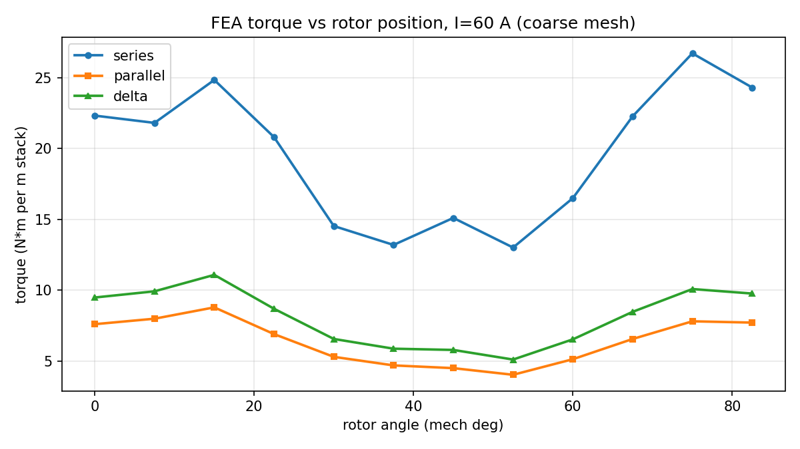
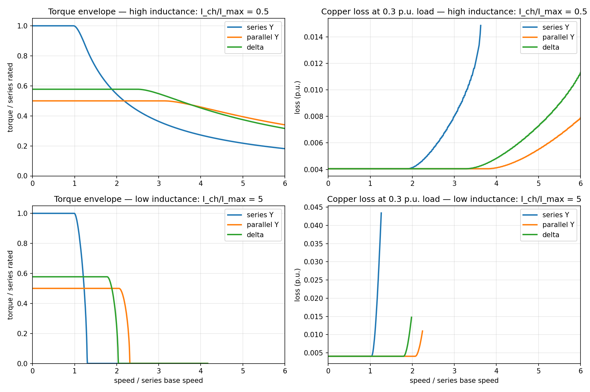

# 绕组切换：转矩-速度包络验证（实测）

日期：2026-10-18　机器：i7-14650HX，纯 CPU　代码：`motor_sweep.py` / `run_sweep.py` / `envelope_two_cases.py`

## 结论先说

**包络没有重合，是明显交叉。** 串联在低速占优，并联/三角形在高速反超；反超点在 **1.9~2.2 倍基速**。所以这个 idea 不该直接否掉，但目标场景被收窄了：**只有经常跑在 2 倍基速以上的应用才值得做**。

同时，收益大小取决于电机的特征电流 `I_ch = λ/L`：

| 机器类型 | 现象 | 切换收益 |
|---|---|---|
| 高电感 `I_ch/I_max = 0.5` | 串联弱磁后转矩平滑下滑 | 2 倍基速以上，同负载铜损低 2~3 倍 |
| 低电感 `I_ch/I_max = 5` | 串联撞硬转速墙，转矩直接归零 | 转速上限拉高约 1.8 倍，但转矩减半 |

## 一、FEA 扫描（3 接法 × 12 转子位置，60 A）

粗网格 60×120，洛伦兹转矩（对网格不敏感：粗 29.8 / 细 30.0 N·m/m；麦克斯韦应力不收敛：122 / 59，弃用）。

| 接法 | 平均转矩 (N·m/m) | 最小 | 最大 | 脉动 | 相对串联 | 气隙 B |
|---|---|---|---|---|---|---|
| 串联 Y | 19.63 | 13.01 | 26.74 | 69.9% | 1.000 | 0.642 T |
| 并联 Y | 6.41 | 4.02 | 8.78 | 74.3% | 0.327 | 0.576 T |
| 三角形 | 8.11 | 5.10 | 11.08 | 73.8% | 0.413 | 0.587 T |

- 拓扑缩放验证通过：**并联 60 A 的转矩 = 串联 30 A 的转矩**（7.60 vs 7.60），三角形 60 A ≈ 串联 34.6 A。说明“半 MMF / 1/√3 MMF”的实现是对的。
- 但 60 A 下实测比值是 0.33 / 0.41，低于 ideal 的 0.50 / 0.577。原因是转矩随电流**超线性**：串联 30/60/120 A 分别为 7.6 / 22.3 / 70.8，线性应为 7.6 / 15.2 / 30.4。非线性来自饱和与电枢反应，不是单纯的缩放。
- 脉动约 70%，这是 12 槽/4 极、无斜极、磁钢 80% 极弧的简化模型导致的齿槽谐波。真实设计会低得多，但这个 demo 不能用来下“脉动合格”的结论。

## 二、包络模型（电压/电流受限 + 弱磁）

单位化：串联额定转矩 = 1，串联基速 = 1；`V=1, I=1, R=0.03`，`λ=1/3`，`I_ch=λ/L`。逐转速在电流圆和电压椭圆内最大化 `T=kt·i_q`。

### 高电感（`I_ch/I_max=0.5`）

- 串联：1.0 倍转矩到 1 倍基速，之后弱磁下滑；2 倍基速时约 0.55，3 倍时约 0.37，4 倍时约 0.28。
- 并联：0.5 倍转矩，平坦到约 3.2 倍基速。
- 三角形：0.577 倍转矩，平坦到约 2.55 倍基速。
- 交叉点：**串联 vs 三角形 1.90 倍基速；串联 vs 并联 2.19 倍基速**。
- 同负载 0.3 p.u. 的铜损：3 倍基速时串联约 0.010，并联约 0.004；4 倍时串联约 0.014，并联约 0.0045。**高速段铜损差 2~3 倍**。

### 低电感（`I_ch/I_max=5`）

- 串联在约 1.3 倍基速撞电压墙，转矩归零（弱磁能力不足）。
- 并联把上限拉到约 2.4 倍基速，但只能输出 0.5 倍转矩；三角形约 2.0 倍、0.577 倍转矩。
- 这是“用转矩换转速”的硬交易，不是平滑的效率优化。

## 三、这对 idea 意味着什么

1. **物理前提成立**：三种接法的包络确实不同，存在可优化的切换空间。不是“重合，直接否掉”。
2. **场景被收窄**：低速伺服/短时过载场景，串联全程更优，切换只增加成本和故障点。只有牵引、宽速域主轴、电动载具这类**经常工作在 2 倍基速以上**的场景才有意义。
3. **必须先测 `I_ch`**：如果目标电机的 `λ/L` 很大（低电感），切换只是把硬转速墙往后推，转矩减半；如果 `λ/L` 小（高电感），高速效率收益才明显。这是选型的第一道门槛。
4. **ML 的理由仍未被证明**：包络本身用 dq 模型就能算，不需要学习。ML 的唯一合理切入点是：FEA 显示强非线性（60 A 转矩比线性高 47%，120 A 高 133%），而线性电路模型抓不到饱和/交叉耦合。**如果这个非线性在可信求解器或实验里成立**，那么“拓扑可变 + 非线性”的代理模型才有存在价值；否则就是给一个已经毫秒级可解的问题加模型。

## 四、必须说明的局限

- 粗网格 60×120；绝对转矩不可信，只看相对趋势和缩放。
- 洛伦兹转矩只算导体受力，不含铁芯受力；与麦克斯韦应力差约 2 倍，绝对值有系统偏差。
- 70% 脉动偏高，磁钢/槽口/斜极都没优化。
- 包络是单位化 dq 模型，`I_ch/I_max` 是假设值，不是某台真实电机的标定值。
- 没有铁损、逆变器损耗、温升、开关瞬态。

## 五、如果继续，最小下一步

1. 拿目标电机的 `λ`、`L`、`R`（数据手册或一次 FEA），算 `I_ch/I_max`。**大于 2 就直接放弃这个方向。**
2. 若 `I_ch/I_max < 1`，做“拓扑可变”数据集：至少 4 种接法（串/并/星/角）× 电流 × 转子角，留一种接法做 zero-shot。
3. 先用可信求解器（或实验）验证 60 A 下 47% 的超线性是否真实；不成立就不要拿它当 ML 动机。
4. 修 FEA：气隙局部加密、槽口倒圆、斜极，再谈脉动和铁损。
